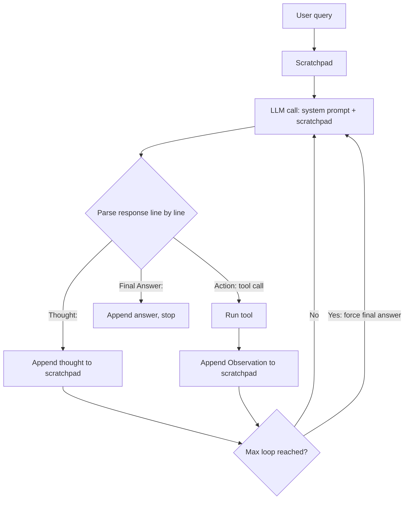

# ReAct Web Research Agent

A from-scratch implementation of the **ReAct (Reason + Act)** pattern in plain Python — no LangChain, no LangGraph. An LLM reasons step by step, decides whether to **search the web** or **read a page**, observes the result, and repeats until it can write a final answer.

The goal of this project is to show how a ReAct loop actually works under the hood: prompt design, output parsing, tool dispatch, and scratchpad management.

---

## How it works



1. The user query is written into a **scratchpad** (a growing text transcript).
2. Each turn, the full scratchpad is sent to the LLM along with the system prompt.
3. The model must reply in a strict plain-text format:
   ```
   Thought: <reasoning>
   Action: web_search(<query>)
   ```
   or, when it has enough information:
   ```
   Thought: <reasoning>
   Final Answer: <answer>
   ```
4. The agent parses the reply line by line. `Thought:` lines are saved, `Action:` lines are executed, and the tool output is appended to the scratchpad as an `Observations:` entry.
5. The loop ends when the model emits `Final Answer:` or when `MAX_LOOP` is reached. On the last allowed turn, the agent tells the model it **must** answer with what it has.

## Tools

| Tool | Description | Backend |
|---|---|---|
| `web_search(query)` | Returns a list of result titles and URLs | [Tavily Search API](https://tavily.com) (`search_depth: advanced`) |
| `fetch_page(url)` | Downloads a page and extracts the `<h1>`, `<h2>`, and all `<p>` text, truncated to **3,000 characters** | `requests` + `BeautifulSoup` |

## Project structure

```
.
├── agent.py       # ReAct loop, LLM client setup, output parsing, tool dispatch
├── prompt.py      # System prompt builder (injects today's date, tool docs, format rules, worked example)
├── tools.py       # web_search and fetch_page implementations
├── config.toml    # Model registry + MAX_LOOP + active model selector
├── main.py        # Empty placeholder (currently unused)
└── .gitignore     # Ignores .env, __pycache__, notebook.ipynb
```

### `config.toml`

Holds the loop limit and a registry of OpenAI-compatible model providers.

```toml
MAX_LOOP = 3        # max research turns
MODEL = "qwen"      # key of the model to use from [models.*]
```

| Key | Provider | Model | API key env var |
|---|---|---|---|
| `minmax` | OpenRouter | `minimax/minimax-m2.5:free` | `OPENROUTER_API_KEY` |
| `gemini` | Google AI Studio | `gemini-3-flash-preview` | `GOOGLE_AI_STUDIO_2` |
| `glm` | Hugging Face router | `zai-org/GLM-5.1:fireworks-ai` | `HF_TOKEN` |
| `qwen` *(default)* | Hugging Face router | `Qwen/Qwen3.6-35B-A3B:featherless-ai` | `HF_TOKEN_2` |
| `freellmapi` | Self-hosted free LLM gateway | `auto` | `FREE_LLM_API` |

Every provider is accessed through the `openai` Python SDK by changing `base_url` and `api_key`, so switching models is a one-line change to `MODEL`.

## Getting started

### Prerequisites

- **Python 3.11+** (uses the built-in `tomllib`)
- A [Tavily](https://tavily.com) API key
- An API key for at least one provider listed in `config.toml`

### Installation

```bash
git clone https://github.com/satyam-sharma7/Project_11_ReAct_Web_Research_Agent.git
cd Project_11_ReAct_Web_Research_Agent

python -m venv venv
source venv/bin/activate        # Windows: venv\Scripts\activate

pip install openai python-dotenv requests beautifulsoup4
```

### Environment variables

Create a `.env` file in the project root (it is git-ignored):

```env
# Search
TAVILY_API=Bearer tvly-xxxxxxxxxxxxxxxx

# LLM provider keys: only the one matching MODEL in config.toml is required
HF_TOKEN_2=hf_xxxxxxxx
# HF_TOKEN=...
# OPENROUTER_API_KEY=...
# GOOGLE_AI_STUDIO_2=...
# FREE_LLM_API=...
```

> **Note:** `tools.py` sends `TAVILY_API` as the raw `Authorization` header value, so the variable must include the `Bearer ` prefix.

### Run

```bash
python agent.py
```

The query is currently hardcoded in `agent.py`:

```python
user = "Compare NVIDIA, AMD, Intel"
```

Edit that line to research something else. When the run finishes, the full scratchpad (every Thought, Action, Observation, and the Final Answer) is printed to the terminal.

## Example scratchpad

```
user: Compare NVIDIA, AMD, Intel

TURN 1
Thought: I need to research each company one by one, starting with NVIDIA.
Action: web_search
Action Input: NVIDIA AI chip strategy
Observations:['Result 1:\nTitle: ...\nUrl: ...\n', ...]

TURN 2
Thought: The first result looks relevant, so I'll read it.
Action: fetch_page
Action Input: https://...
Observations:NVIDIA is focusing on ...

TURN 3
You have reached the maximum number of research steps. You MUST now issue your Final Answer ...
Thought: I have enough information to compare the three companies.
Final Answer: ...
```

## Design notes

- **Scratchpad, not chat history.** The whole transcript is sent as a single user message each turn, which keeps the ReAct format explicit and easy to debug.
- **Line-based parsing.** The system prompt forbids JSON and markdown so that responses can be parsed with simple `startswith("Thought:")` / `startswith("Action:")` checks and a regex.
- **Date injection.** `build_system_prompt()` inserts today's date so the model prefers recent information.
- **Forced termination.** The final turn appends an explicit instruction to answer, so the agent always produces a result even if the model would keep searching.
- **Provider-agnostic.** Any OpenAI-compatible endpoint works by adding a new `[models.<name>]` block.

## Known limitations

These are real gaps in the current code, listed so they can be fixed:

- **Hardcoded query.** There is no CLI or input prompt, and `agent.py` runs the loop at import time. `main.py` is empty.
- **No `requirements.txt`.** Dependencies must be installed manually (see above).
- **`temperature` and `max_tokens` in `config.toml` are never passed** to the API call, so provider defaults are used.
- **Multiple actions per turn are not blocked.** The prompt asks for one action, but the parser executes every `Action:` line the model returns.
- **Fragile action parsing.** The regex splits on parentheses, so a search query containing `(` or `)` will be truncated.
- **Unhandled errors.** `fetch_page` crashes if a page has no `<h1>` or `<h2>`; neither tool has timeouts, status-code checks, or exception handling; an unknown tool name raises a `KeyError`.
- **Tiny page budget.** Only the first 3,000 characters of a page are returned, and `<h1>`/`<h2>` are taken only once (first match).
- **Search returns links only.** `web_search` drops Tavily's content snippets, so every answer requires an extra `fetch_page` call, which is costly with `MAX_LOOP = 3`.
- **Gemini config likely needs a different base URL.** Google's OpenAI-compatible endpoint is `https://generativelanguage.googleapis.com/v1beta/openai/`.
- **Debug output.** `print(response)` dumps the raw API response every turn.
- **No tests or evaluation.**

## Roadmap

- [ ] Accept the query via CLI argument (`argparse`) and move the loop into `main.py` under `if __name__ == "__main__":`
- [ ] Add `requirements.txt` and a `.env.example`
- [ ] Wire `temperature` / `max_tokens` from config into the API call
- [ ] Add error handling, timeouts, and retries to the tools
- [ ] Use Tavily's returned `content` snippets in search results
- [ ] Enforce one action per turn and make parsing robust to nested parentheses
- [ ] Raise `MAX_LOOP` and add a token/character budget for the scratchpad
- [ ] Stream the final answer and save it to a Markdown report
- [ ] Add tests for the parser and tools

## Tech stack

Python · OpenAI SDK (OpenAI-compatible endpoints) · Tavily API · Requests · BeautifulSoup4 · python-dotenv · TOML

## Author

**Satyam Sharma**
[GitHub](https://github.com/satyam-sharma7) · [LinkedIn](https://www.linkedin.com/in/satyam-sharma-778383379/)
